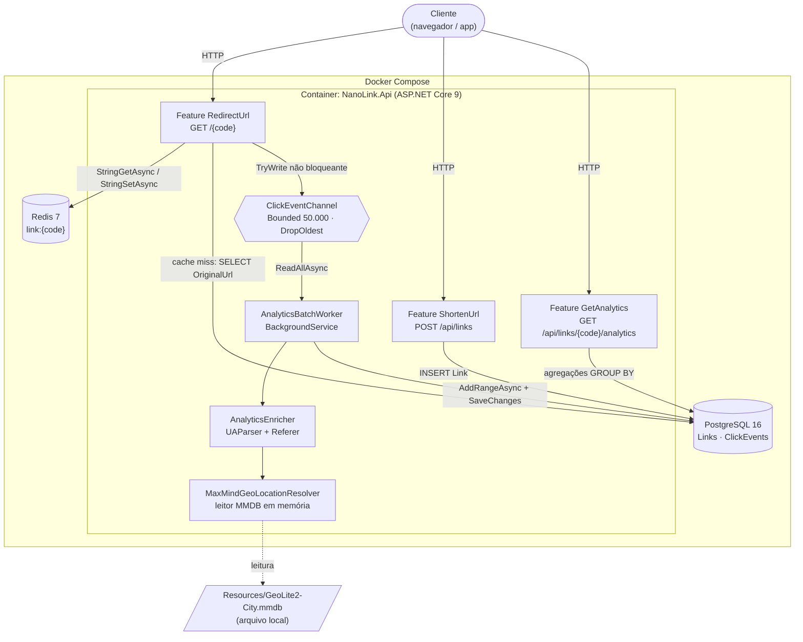
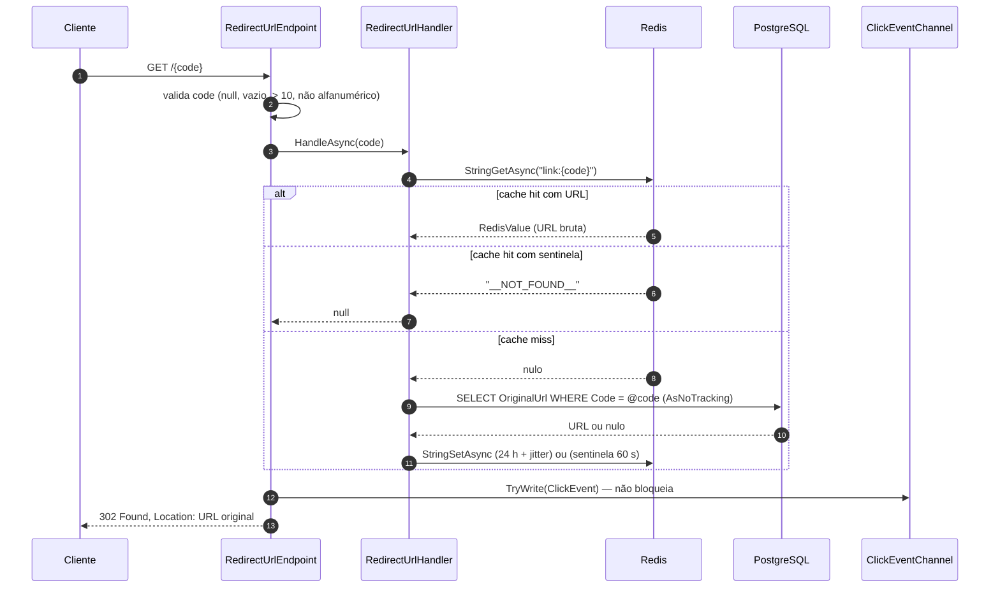
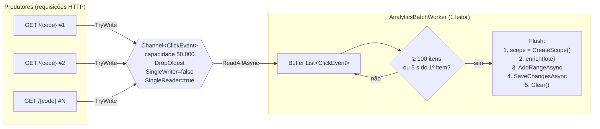

# Arquitetura do NanoLink

Este documento detalha as decisões de arquitetura do NanoLink para revisão técnica. Para uma visão rápida, veja o [README](README.md). As decisões formais estão em [docs/adr/](docs/adr/).

## Sumário

1. [Visão arquitetural C4 (Container)](#visão-arquitetural-c4-container)
2. [Caminho Crítico vs Caminho em Background](#caminho-crítico-vs-caminho-em-background)
3. [Diagnósticos, Trade-offs e Lições Aprendidas](#diagnósticos-trade-offs-e-lições-aprendidas)

---

## Visão arquitetural C4 (Container)

O diagrama abaixo mostra os contêineres de execução e como eles se comunicam. A API é um único processo ASP.NET Core que hospeda os endpoints HTTP e o worker de analytics em segundo plano.



**Leitura do diagrama:** a seta de `Redirect` para `Channel` é a única ligação entre o caminho crítico e o background. Ela é um `TryWrite` que nunca espera. Toda a geolocalização e o parse de User-Agent acontecem do lado direito, dentro do worker.

### Componentes e responsabilidades

| Componente | Responsabilidade | Tecnologia |
|---|---|---|
| `RedirectUrl` (slice) | Resolve o código, responde 302 e publica o clique | `RedirectUrlHandler`, `RedirectUrlEndpoint` |
| `ShortenUrl` (slice) | Valida, gera o código Base62 e persiste | FluentValidation, EF Core |
| `GetAnalytics` (slice) | Agrega métricas direto no PostgreSQL | EF Core `GroupBy` com `AsNoTracking` |
| `RedisCacheService` | Cache de URLs e negative caching | StackExchange.Redis, `IConnectionMultiplexer` singleton |
| `ClickEventChannel` | Fila em memória entre o endpoint e o worker | `System.Threading.Channels` |
| `AnalyticsBatchWorker` | Consome o canal, enriquece e grava em lote | `BackgroundService`, `IServiceScopeFactory` |
| `AnalyticsEnricher` | Extrai SO, dispositivo e domínio do Referer | UAParser 3.x |
| `MaxMindGeoLocationResolver` | País e cidade a partir do IP, offline | MaxMind.GeoIP2 6.x, `DatabaseReader` singleton |
| Rate limiter | Limita criações por IP | `System.Threading.RateLimiting`, janela fixa |

### Modelo de dados

```text
Links                              ClickEvents
─────────────────────────          ─────────────────────────────────────
Id              uuid  PK           Id                 uuid  PK
Code            varchar(10) UNIQUE Code               varchar(10)  INDEX
OriginalUrl     varchar(2048)      ClickedAt          timestamptz  INDEX
CreatedAt       timestamptz        UserAgent          text
                                   Referer            text
                                   IpAddress          varchar(45)
                                   CountryCode        varchar(2)
                                   CountryName        varchar(100)
                                   CityName           varchar(100)
                                   OperatingSystem    varchar(50)
                                   DeviceType         varchar(30)
                                   ReferrerDomain     varchar(150)
```

---

## Caminho Crítico vs Caminho em Background

O NanoLink separa explicitamente duas preocupações. O **caminho crítico** é o redirecionamento `GET /{code}`, que precisa responder rápido. O **caminho em background** é a gravação e o enriquecimento dos cliques, que podem levar o tempo que for necessário sem afetar o usuário.

### 1. Caminho crítico: `GET /{code}`



Pontos importantes do caminho crítico:

- **Nenhum JSON no caminho.** A URL é gravada e lida como string bruta no Redis (`StringSetAsync` / `StringGetAsync`). Não há `JsonSerializer` no redirect. A regra está registrada na CONSTITUTION da fase 03.
- **Alocação real, medida em termos honestos.** O caminho não é zero-alocação. Ele aloca: a `string` materializada a partir do `RedisValue`, o objeto `ClickEvent` (com seus campos), o `IResult` do `Results.Redirect` e a `Task` do handler. O ganho está em não serializar nem desserializar objetos, o que elimina a parte mais cara em CPU e memória transitória.
- **Consulta mínima no banco.** No cache miss, o EF Core faz `AsNoTracking()` e `Select(l => l.OriginalUrl)`. O SQL traz uma coluna, não a entidade, e nenhuma instância é rastreada pelo change tracker.
- **Publicação não bloqueante.** `TryWrite` retorna imediatamente. Se o canal estiver cheio, o comportamento é definido pela política de descarte (seção abaixo), e o redirect continua sendo respondido.
- **Ordem de publicação.** O clique é enfileirado **depois** de a URL ser resolvida e **antes** do `302`. Um erro de banco no caminho de analytics nunca chega ao usuário, porque o analytics não roda neste caminho.
- **Sentinela de negative caching.** `__NOT_FOUND__` tem TTL de 60 s. Um código inexistente, repetido, é respondido 404 pelo Redis, sem nova consulta ao PostgreSQL. Isso protege contra cache penetration ([ADR 0004](docs/adr/0004-redis-negative-caching-and-jitter.md)).

**Latência medida localmente:** em 250 requisições sequenciais via `curl` contra a API em contêiner, com o cache aquecido, a média foi de **4,4 ms** e o máximo de 351 ms, provavelmente a primeira conexão. Isso é uma medição pontual em uma máquina de desenvolvimento, não um benchmark de carga. A meta de < 5 ms não foi validada sob concorrência.

### 2. Caminho em background: Bounded Channel e Batch Worker



#### Bounded Channel: capacidade e descarte

O canal é criado com `BoundedChannelOptions(50_000)`, `FullMode = DropOldest`, `SingleWriter = false` e `SingleReader = true`:

- **Capacidade de 50.000 eventos.** Cada `ClickEvent` ocupa algumas centenas de bytes, então a estimativa do teto de memória é de alguns a algumas dezenas de megabytes (estimativa, não medida). Esse valor é o que impede que um pico de tráfego consuma toda a RAM.
- **`DropOldest`.** Quando o canal enche, o item **mais antigo** é descartado para dar lugar ao novo. A escolha privilegia o presente: em um pico, o analytics mais recente é mais útil do que um atrasado, e a API continua disponível. O `TryWrite` ainda retorna `true` nesse caso, porque a escrita aconteceu.
- **Por que não `Channel.CreateUnbounded`.** Uma fila sem limite, sob um ataque, cresce até `OutOfMemoryException` e derruba o processo inteiro, inclusive o redirecionamento. A regra é proibitiva na CONSTITUTION da fase 04.
- **`SingleWriter = false`.** Muitas requisições escrevem em paralelo. Já `SingleReader = true` permite à implementação otimizar o consumo, porque só o worker lê.

#### Batch Worker: flush por tamanho ou por tempo

O worker espera itens com `ReadAllAsync` e mantém um buffer. Ele faz flush quando **uma** das condições acontece:

1. **Tamanho:** o buffer atinge 100 itens. Esse é o caso de pico, em que o worker grava lotes cheios.
2. **Tempo:** passaram 5 s desde o **primeiro** item do lote. Garante que um clique isolado seja gravado em no máximo ~5 s, mesmo com pouco tráfego.

O prazo de 5 s é armado no momento em que o primeiro item chega. Esse detalhe foi um bug real corrigido durante a implementação: quando o buffer estava vazio, o timer não era armado e um lote parcial ficava preso indefinidamente. A correção é descrita nas [lições aprendidas](#diagnósticos-trade-offs-e-lições-aprendidas).

**Resolução segura de dependências.** `AppDbContext` é `Scoped` e o worker é `Singleton` (um `BackgroundService`). Injetar o contexto diretamente criaria um contexto de vida longa, que acumula estado e quebra o isolamento entre lotes. Por isso cada flush cria um escopo com `IServiceScopeFactory.CreateScope()`, resolve `AppDbContext` e o `IAnalyticsEnricher` dentro dele, e descarta tudo ao final:

```csharp
using var scope = scopeFactory.CreateScope();
var db = scope.ServiceProvider.GetRequiredService<AppDbContext>();
var enricher = scope.ServiceProvider.GetRequiredService<IAnalyticsEnricher>();

foreach (var evt in _buffer) enricher.EnrichEvent(evt);

await db.ClickEvents.AddRangeAsync(_buffer, ct);
await db.SaveChangesAsync(ct);
```

**Tolerância a falhas.** Qualquer exceção no flush é capturada, registrada como erro, e o lote é descartado (`finally` limpa o buffer). O worker continua rodando, e a API nunca cai por falha de banco de analytics.

**Desligamento gracioso.** `StopAsync` chama `Complete()` no canal, o que impede novas escritas, e aguarda o worker drenar o restante. O worker lê até o canal ficar vazio, faz o último flush com `CancellationToken.None` e só então termina.

---

## Diagnósticos, Trade-offs e Lições Aprendidas

### Isolamento de portas e concorrência com serviços locais do Windows

**O problema.** Na máquina de desenvolvimento havia dois serviços PostgreSQL nativos do Windows (versões 15 e 18), escutando em `0.0.0.0:5432` e `0.0.0.0:5433`. O Docker publicava o PostgreSQL do compose nas mesmas portas, mas no Windows o Docker só conseguiu escutar em IPv6 (`::`). O resultado foi que `localhost` (que resolve para `127.0.0.1` primeiro) caía no PostgreSQL nativo, e não no container.

**Impacto observado.** Testes de integração e de execução local gravaram dados e migrações em um banco nativo que não era o pretendido. Só ficou claro com uma verificação explícita: `psql -h 127.0.0.1` respondia "banco `nanolink` não existe" na porta 5433, enquanto o container estava saudável.

**Mitigação adotada.** Para validar contra o banco do Docker, a API foi executada **dentro** da rede do compose, onde ela alcança `postgres:5432` pelo nome do serviço, sem passar pelas portas do host.

**Lição.** Antes de depurar a aplicação, confirme qual processo de fato atende cada porta (`Get-NetTCPConnection`). Em Windows com instalações nativas, uma porta publicada pelo Docker pode estar sombreada. A correção definitiva é parar os serviços nativos ou mudar a porta publicada, o que depende de decisão do ambiente.

### Transição para .NET 9 e adoção do OpenAPI nativo

Não houve transição de .NET 8 para .NET 9 neste projeto. O `TargetFramework` é `net9.0` desde o início, e o nome do repositório (`NanoLink-Net8-Docker-SQL-Redis`) é um resquício de planejamento, não do código.

A decisão relevante foi a **documentação da API**. Em vez de adicionar um gerador de documentação de terceiros, o projeto usa `Microsoft.AspNetCore.OpenApi` (`AddOpenApi` e `MapOpenApi`), que é o suporte nativo do ASP.NET Core 9, com a UI do Scalar por cima. Os motivos estão na [ADR 0007](docs/adr/0007-scalar-modern-api-reference.md). Em resumo: menos dependências, geração de documento em tempo de execução acoplada ao próprio framework, e uma UI moderna sem reconfiguração de rotas.

### Estratégia de testes com Testcontainers: API do Docker local vs runner do GitHub Actions

**O problema.** A versão de `Testcontainers` 4.16 usa o cliente `Docker.DotNet` com a API Docker 1.44. O Docker Engine desta máquina (20.10.22) só aceita até a API 1.41. Resultado: `client version 1.44 is too new. Maximum supported API version is 1.41`, que aparece como falha de conexão genérica (`DockerUnavailableException`), e não como erro de versão, o que dificulta o diagnóstico.

**Mitigação local.** A variável `DOCKER_API_VERSION=1.41` é lida pela biblioteca e fixa a versão negociada. Ela só afeta a execução local, sem mudar código nem o Docker Desktop.

**Por que o CI não precisa disso.** O runner `ubuntu-latest` do GitHub Actions traz um Docker Engine mais novo, compatível com a API 1.44. A variável não é definida no workflow, e a suíte roda sem ajuste.

**Trade-off.** O comportamento depende do Docker do ambiente. Quando a diferença de versão aparecer, a mensagem de erro precisa ser lida com cuidado: a causa pode não ser conexão.

### Outras lições técnicas

| Problema | Causa | Correção |
|---|---|---|
| Worker gravava lotes parciais com atraso indefinido | O timer de 5 s só era armado se o buffer já tivesse itens ao entrar na espera | Armar o timer no primeiro item recebido |
| Analytics quebrava com `No coercion operator ... DateTimeOffset and Nullable<DateTime>` | Agrupar por `ClickedAt.UtcDateTime.Date` gerava SQL cujo tipo de retorno não batia com o do shaper do EF | Agrupar por `Year`, `Month` e `Day`, que são inteiros |
| Conflito `MSB3277` entre versões de EF Core nos testes | `Npgsql.EntityFrameworkCore.PostgreSQL` 9.0.4 traz `EntityFrameworkCore.Relational` 9.0.1, enquanto a API usa 9.0.21 | Fixar `EntityFrameworkCore` e `Relational` em 9.0.21 no projeto de testes |
| `Parser.GetDefault()` não compila no UAParser 3.x | A versão 3.x removeu a sobrecarga sem argumentos | Usar `Parser.GetDefault(new ParserOptions())` |
| Build falhava com `MSB3027` (arquivo bloqueado) | Processos `NanoLink.Api.exe` órfãos de execuções anteriores travavam o `bin` | Encerrar processos que rodam a partir do `bin` do projeto antes de compilar |
| Testes de rate limit interferiam entre si | Todos os testes compartilham uma factory, e o `TestServer` não tem IP, então caem na mesma partição `anonymous` | Manter o número de POSTs da suíte abaixo do limite e documentar a dependência |

### Trade-offs arquiteturais assumidos

| Decisão | Ganho | Custo aceito |
|---|---|---|
| Cache apenas em Redis, sem camada em memória (L1) | Uma única fonte de verdade, sem invalidação entre instâncias | Cada hit paga um round-trip à rede. Uma camada L1 reduziria isso, mas não existe no projeto |
| Analytics em memória com `DropOldest` | API nunca bloqueia nem estoura RAM sob pico | Cliques descartados em sobrecarga são perdidos, e não há contador de descartes |
| Lote com falha descartado, sem retry | Worker simples, sem fila de reprocessamento | Semântica *at-most-once*: uma falha de banco perde até 100 cliques |
| Redirect `302 Found`, não `301` | Navegadores não cacheiam o redirect, então cada clique chega à API e pode ser medido | Mais requisições ao servidor do que com `301` |
| Rate limit por IP | Simples e nativo, sem dependência externa | Atrás de NAT, muitos usuários compartilham um IP. O limite é por instância, não distribuído |
| `X-Forwarded-For` confiado diretamente | Permite testar IPs reais via `.http` e funciona atrás de proxy | Qualquer cliente que chegue direto na API pode forjar o IP de analytics. Em produção, só deve ser aceito de um proxy confiável |
| Geolocalização com base MaxMind local | Offline, sem latência de rede e sem envio de IPs a terceiros | Exige a base no servidor e licença da MaxMind. A base não é versionada no repositório |
| Código Base62 de 7 caracteres sem retry | Geração simples e segura | Uma colisão no índice único gera erro 500. A probabilidade é baixa (62⁷ ≈ 3,5 trilhões), mas o tratamento não existe |
| Escala horizontal sem coordenação | Cada instância tem seu canal e seu worker | Rate limit e analytics em buffer são por instância. Com N réplicas, o limite efetivo é N vezes o configurado |

### Próximos passos recomendados

- Expor métricas de descartes do canal e de falhas de lote (contadores), para tornar a perda visível.
- Adicionar retry com backoff para lotes que falham, ou mover a fila para um broker quando a perda precisar ser zero ([ADR 0003](docs/adr/0003-write-behind-pattern-via-channels.md)).
- Tratar colisão de código com nova tentativa antes de estourar o índice único.
- Usar rate limit distribuído (Redis) se o número de réplicas crescer.
- Medir a latência com uma ferramenta de carga (ex.: k6 ou bombardier) antes de afirmar a meta de 5 ms.
